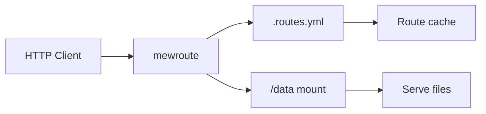

# mewroute

[](https://github.com/mewisme/mewroute/actions/workflows/release.yml) [](https://github.com/mewisme/mewroute/releases/latest) [](go.mod) [](https://hub.docker.com/r/mewisme/mewroute) [](https://github.com/mewisme/mewroute/pkgs/container/mewroute) [](LICENSE)

**mewroute** is a lightweight, configurable static file router. It serves files from a directory over HTTP with per-folder routing rules, rewrites, redirects, named route parameters, and SPA-style `dist` fallbacks.

It ships as two deployment targets that share the same data format (`.routes.yml`, `.config.yml`):

| Target | Where | Notes |
|--------|-------|-------|
| **Go server / Docker** | `cmd/`, `internal/`, [Dockerfile](Dockerfile) | Long-running process, live filesystem, hot reload |
| **Cloudflare Workers** | [`worker/`](worker/README.md) | TypeScript port; files as Static Assets, routes in KV |

| Feature | Go server | Worker |
|---|---|---|
| Hot reload | yes (fsnotify + polling) | no (redeploy) |
| `Range` requests | yes | single range, buffered |
| Directory listing / README render | yes | yes (built at deploy) |
| Symlinks | served only if inside root | never published |
| Invalid config | logged and skipped | fails the build |
| Health check | `/healthz` | `/healthz` |

**Security model:** mewroute never executes files. Scripts (`.sh`, `.ps1`, `.bat`, `.js`, etc.) are always returned as static content.



## Features

- Default filesystem routing (`/path/to/file` maps to `data/path/to/file`)
- Per-directory `.routes.yml` configuration (nested scopes)
- Rewrite, redirect, file, and dist (SPA) routes
- Wildcard routes (`/docs/*`)
- Named route params: `/{repo}.{ext}` with `params.<name>.allow` allow-lists and `{param}` / `{git.username}` interpolation in targets
- Git shortcut (`/git/...` → GitHub) from `.config.yml`
- Directory listings (opt-in)
- Automatic README.md → HTML rendering for directory URLs
- Custom response headers per scope
- Hot reload of configuration and file metadata caches
- Structured JSON logging
- `GET` / `HEAD`, MIME types, `ETag`, `Last-Modified`, range requests
- Single static binary, Alpine Docker image (~10 MB)
- Optional Cloudflare Workers deployment (see [Cloudflare Workers](#cloudflare-workers))

## Quick start

### Docker Compose

```bash
git clone https://github.com/mewisme/mewroute.git
cd mewroute
docker compose up -d
```

Pulls `ghcr.io/mewisme/mewroute:0.0.6`. Open [http://localhost:8080/app/](http://localhost:8080/app/) for the demo SPA, or [http://localhost:8080/scripts/hello](http://localhost:8080/scripts/hello) for a rewrite example.

Mount your own content by replacing the `./data` volume in `docker-compose.yml`:

```yaml
volumes:
  - ./data:/data:ro
```

### Docker

```bash
docker pull ghcr.io/mewisme/mewroute:latest
# or: docker pull mewisme/mewroute:latest
docker run --rm -p 8080:8080 -v "$(pwd)/data:/data:ro" ghcr.io/mewisme/mewroute:latest
```

Published images (GHCR + Docker Hub) are **multi-arch manifests** (`linux/amd64`, `linux/arm64`). Tags like `latest` or `1.0.0` auto-select the correct architecture on pull.

Releases are published by [GoReleaser](.goreleaser.yaml) when you push a semver tag (`v1.0.0`): GitHub Release binaries plus images to `ghcr.io/mewisme/mewroute` and `mewisme/mewroute` ([Release workflow](.github/workflows/release.yml)). The [Dockerfile](Dockerfile) only copies the prebuilt binary (`$TARGETPLATFORM/mewroute`).

### Binary

Download from [GitHub Releases](https://github.com/mewisme/mewroute/releases), or build with **Go 1.26+**:

```bash
go build -o mewroute ./cmd/mewroute
ROOT_DIR=./data PORT=8080 ./mewroute
```

### Cloudflare Workers

The [`worker/`](worker/README.md) project deploys the same data directory to Cloudflare Workers. A build step compiles the data dir into Static Assets (`public/`) plus a `manifest.json` (route table, file tree, rendered READMEs) stored in Workers KV.

```bash
cd worker
pnpm install
MEWROUTE_DATA=/path/to/data pnpm dev       # local: http://localhost:8787
MEWROUTE_DATA=/path/to/data pnpm run deploy  # assets + code, then manifest to KV
MEWROUTE_DATA=/path/to/data pnpm sync-config # routes/config only, no redeploy
```

Data dir resolution: `--data <path>` > `MEWROUTE_DATA` > `../data`. First deploy needs a KV namespace (`pnpm exec wrangler kv namespace create MANIFEST`, then set its `id` in `worker/wrangler.jsonc`).

Differences from the Go server: dotfiles/dotdirs, `node_modules` and symlinks are never published; invalid config fails the build (Go logs and skips the scope); no hot reload; `Range` requests return the full body. Adding or changing **files** needs `pnpm run deploy`; changing only `.routes.yml` / `.config.yml` can use `pnpm sync-config` (KV propagation ~60 s plus a 30 s isolate cache). Details: [worker/README.md](worker/README.md).

## Directory layout

```
data/
  scripts/
    hello.ps1
    .routes.yml
  tools/
    linux/
      setup.sh
  app/
    .routes.yml
    build/
      index.html
      assets/
```

Without configuration, files are exposed at their filesystem path:

| File | URL |
|------|-----|
| `data/scripts/hello.ps1` | `GET /scripts/hello.ps1` |
| `data/tools/linux/setup.sh` | `GET /tools/linux/setup.sh` |

## Routing priority

Requests are resolved in this order:

1. **Exact** configured routes
2. **Param** configured routes (`{name}` in `from`)
3. **Wildcard** configured routes (`*` in `from`)
4. **Git** shortcut (`/git` → GitHub redirects when configured in `.config.yml`)
5. **Dist** routes (longest URL prefix match)
6. **Physical file** on disk
7. **Directory index** (`index.html`, `index.htm`)
8. **README** (`readme.md`, any case) — auto-rendered as HTML
9. **Directory listing** (if `listing: true` for the scope)
10. **404**

Within exact, param, and wildcard routes, routes from the deepest scope win, then the longer `from` path.

Each `.routes.yml` applies only to its directory and subdirectories. Child directories may define their own configuration. When multiple scopes match, the **longest URL prefix** wins for headers, listing, and dist.

## `.config.yml` (global)

Place `.config.yml` in the content root (`data/.config.yml`). This file holds global settings and is **not** publicly accessible (always `404`). Copy from [`data/.config.yml.example`](data/.config.yml.example); the live file is gitignored.

### Git shortcut

Redirects to GitHub without any `.routes.yml` entries:

```yaml
git:
  username: mewisme   # default GitHub username
  route: /git         # optional URL prefix (default: /git)
```

| Request | Redirect |
|---------|----------|
| `GET /git` | `https://github.com/mewisme` |
| `GET /git/wrec` | `https://github.com/mewisme/wrec` |
| `GET /git/mewisme/wrec` | `https://github.com/mewisme/wrec` |

The git shortcut is inactive when `.config.yml` is missing or `git.username` is empty. Configured `.routes.yml` exact and wildcard routes still take priority over the git matcher.

## `.routes.yml` reference

Place `.routes.yml` in any directory under `ROOT_DIR`, including the content root itself (`data/.routes.yml`). Route `from` paths are relative to that directory's URL prefix.

**Target paths (`to`):**

- `./file` or `file` — relative to the config file's directory
- `/scripts/file` — relative to `ROOT_DIR` (content root)

| Field | Description |
|-------|-------------|
| `routes` | List of route rules |
| `routes[].from` | URL path suffix (e.g. `/hello`, `hello`, `/api/*`) |
| `routes[].to` | Target path (relative to config directory, or `/`-rooted from `ROOT_DIR`) or redirect URL |
| `routes[].type` | `rewrite`, `redirect`, or `file` |
| `routes[].status` | Redirect only: `301`, `302`, `307`, `308` |
| `routes[].download` | File only: set `Content-Disposition: attachment` |
| `dist.path` | Directory to serve (relative path) |
| `dist.fallback` | SPA fallback file when no asset matches |
| `listing` | `true` / `false` (default: `false`) |
| `routes[].params` | Param routes only: `params.<name>.allow` restricts a `{name}` to a list of values |
| `headers` | Custom headers applied to responses in this scope |

### Rewrite

`data/scripts/.routes.yml`:

```yaml
routes:
  - from: /hello
    to: ./hello.ps1
    type: rewrite
```

| Request | Result |
|---------|--------|
| `GET /scripts/hello` | Serves `hello.ps1` (URL unchanged) |

### Redirect

Same-site path:

```yaml
routes:
  - from: /old
    to: /scripts/hello
    type: redirect
    status: 302
```

External domain:

```yaml
routes:
  - from: /docs
    to: https://example.com/docs
    type: redirect
    status: 301
```

Redirect `to` accepts:

- Same-site paths: `/scripts/hello`, `hello`
- External URLs: `https://example.com/path`, `http://example.com`
- Protocol-relative URLs: `//cdn.example.com/asset.js`

Only `http` and `https` schemes are allowed.

### File download

```yaml
routes:
  - from: /download
    to: ./hello.ps1
    type: file
    download: true
```

### Dist / SPA

`data/app/.routes.yml`:

```yaml
dist:
  path: ./build
  fallback: index.html

headers:
  Cache-Control: no-store
  X-App: demo
```

| Request | Serves |
|---------|--------|
| `GET /app/` | `build/index.html` |
| `GET /app/users/1` | `build/index.html` (fallback) |
| `GET /app/assets/main.js` | `build/assets/main.js` |

### Wildcard

```yaml
routes:
  - from: /docs/*
    to: ./hello.ps1
    type: file
```

### Named params

`{name}` placeholders in `from` each match one path segment (`[^/]+`) and can be reused in `to`. Names start with a letter and use letters, digits, `_`, `-`. `{git.username}` (from `.config.yml`) is also available in targets.

`data/.routes.yml`:

```yaml
routes:
  - from: /{repo}.{ext}
    to: https://raw.githubusercontent.com/{git.username}/{repo}/refs/heads/main/install.{ext}
    type: redirect
    params:
      ext:
        allow: [sh, ps1]
```

| Request | Result |
|---------|--------|
| `GET /wrec.ps1` | `302` → `https://raw.githubusercontent.com/mewisme/wrec/refs/heads/main/install.ps1` |
| `GET /wrec.exe` | `404` (`exe` not in `allow`; resolution continues to the next route) |

Rules:

- Exact routes win over param routes.
- Cannot be mixed with `*` in the same `from`.
- `allow` values must be non-empty, unique, and must not contain `/`.
- Every `{placeholder}` in `to` must be a declared param or `git.username`; otherwise the config is invalid.
- A target with a placeholder that has no value (e.g. `{git.username}` without a git username) returns `404`.

### Directory listing

```yaml
listing: true
```

### README rendering

If a directory contains `readme.md` (any casing, e.g. `README.md`, `readme.MD`), visiting that directory URL automatically serves the file rendered as HTML. No `.routes.yml` entry is required.

| File | URL |
|------|-----|
| `data/readme.md` | `GET /` |
| `data/docs/README.md` | `GET /docs/` |

`index.html` takes priority over `readme.md`. Direct file access (e.g. `GET /readme.md`) still returns the raw markdown file.

## Environment variables

| Variable | Default | Description |
|----------|---------|-------------|
| `ROOT_DIR` | `/data` | Content root directory |
| `PORT` | `8080` | HTTP listen port |
| `LOG_LEVEL` | `info` | `debug`, `info`, `warn`, `error` |
| `READ_TIMEOUT` | `30s` | Server read timeout |
| `WRITE_TIMEOUT` | `60s` | Server write timeout |
| `WATCH_POLL_INTERVAL` | `5s` | Rescan `ROOT_DIR` for new folders and refresh caches (`0` disables polling) |

## Security

- **Read-only mount** recommended (`:ro` in Docker)
- **Path traversal** blocked via canonical path checks; symlinks that resolve outside `ROOT_DIR` are never served (`404`)
- **`.routes.yml`** and **`.config.yml`** are never publicly accessible (always `404`)
- Files are **never executed** — only served as content
- Only `GET` and `HEAD` are allowed (`405` otherwise)

## Health check

```
GET /healthz → 200 ok
```

## Architecture

```
cmd/mewroute/          Entry point
internal/
  app/                 Wiring and lifecycle
  config/              Env + YAML parsing (.routes.yml, .config.yml)
  router/              Route table and resolution
  filesystem/          Safe paths, caching, file serving
  listing/             HTML directory index
  server/              HTTP handler
  watcher/             fsnotify hot reload
  logx/                Structured logging
worker/                Cloudflare Workers target (TypeScript: resolver port, build step, deploy)
```

Caches:

- **Route cache** — atomic snapshot of all `.routes.yml` rules and `.config.yml` global settings
- **Stat cache** — file metadata, invalidated on filesystem changes
- **Config reload** — debounced via `fsnotify` (no restart required)
- **Live content updates** — edit files under `data/` on the host while mewroute is running; changes are picked up automatically (new folders are detected every `WATCH_POLL_INTERVAL`)
- **Workers** — no live filesystem: the build step produces a manifest (route table, file/dir tree, rendered READMEs) read from KV and cached 30 s per isolate

## Troubleshooting

### `Permission denied` when creating files in `data/` on the host

The `:ro` flag in `docker-compose.yml` only makes the mount **read-only inside the container**. It does **not** block you from editing `./data` on the server.

If `mkdir` or `cp` fails on the host, the directory is usually owned by `root` because Docker was run with `sudo`:

```bash
ls -la ~/docker/mewroute/data
sudo chown -R "$USER:$USER" ~/docker/mewroute/data
chmod -R u+rwx ~/docker/mewroute/data
mkdir ~/docker/mewroute/data/wrec
```

Avoid `sudo docker compose` for day-to-day use so new files stay owned by your user. mewroute only needs read access inside the container.

## Development

```bash
# Go
go test -race -cover ./...
go vet ./...
ROOT_DIR=./testdata go run ./cmd/mewroute

# Worker
cd worker
pnpm install
pnpm typecheck
pnpm test
```

See [CONTRIBUTING.md](CONTRIBUTING.md) for contribution guidelines.

## License

[MIT](LICENSE)
